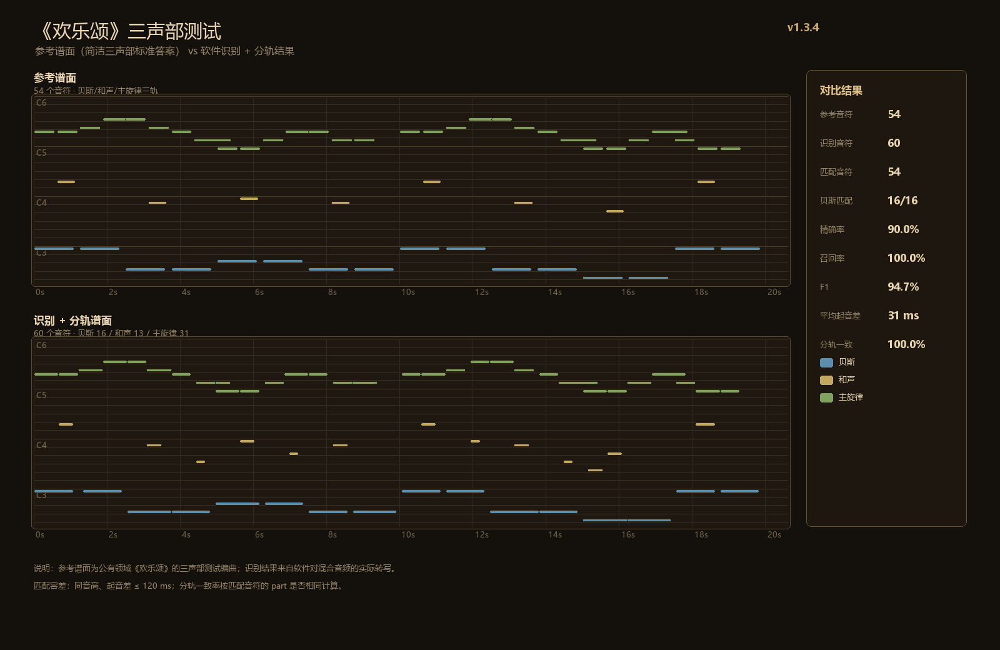

# 旋律抄谱机 · Melody Scribe

把音频转成可编辑的钢琴卷帘谱，并导出 MIDI / WAV / JSON。

- 单音旋律识别：适合人声、笛子、提琴等单声部素材
- 复音识别：基于 [Basic Pitch](https://github.com/spotify/basic-pitch-ts)，可识别和弦、伴奏与低音
- 音符级分轨：鼓组 / 贝斯 / 和声 / 主旋律，可分轨静音、分轨导出 MIDI
- NCM 解密：支持网易云音乐 `.ncm` 本地转 MP3 / FLAC
- 本地离线：音频不上传服务器
- Windows 独立窗口：WebView2 外壳，自带图标与安装脚本

> 这是**音符级分轨**，不是 Demucs 那类音源分离，不会生成每个乐器的 WAV 分轨。



## 目录

- [功能](#功能)
- [下载与安装](#下载与安装)
- [从源码运行](#从源码运行)
- [构建](#构建)
- [项目结构](#项目结构)
- [已知限制](#已知限制)
- [NCM 与版权](#ncm-与版权)
- [作者](#作者)
- [许可证](#许可证)

## 功能

### 识别

- 导入 WAV / MP3 / FLAC / M4A / OGG / NCM
- 麦克风录制
- 单音 YIN 识别与复音 Basic Pitch 识别
- 自动 BPM、拍号、小节与网格
- 导入识别时显示确定性进度条：已处理时间 / 总时长 / 剩余时间

### 编辑

- 钢琴卷帘写入、擦除、拖动、改音长
- 撤销 / 重做
- 试听、节拍器、循环
- 手动画小节、修改 BPM

### 分轨与导出

- 按音域、包络、频谱特征分成鼓组、贝斯、和声、主旋律
- 分轨 MIDI 导出：Bass / Harmony / Melody 三条轨道
- 未点「分轨」时默认单轨导出，适合钢琴独奏
- 导出 MIDI、转录 WAV、原文件、JSON 快照
- 侧栏「导出位置」可一键打开 Windows 下载文件夹

### NCM

- 直接导入 `.ncm` 后自动解密并进入识别
- 侧栏「NCM 转 MP3 / FLAC」只转换、不识别
- 原格式导出，不做二次有损转码

## 下载与安装

到 GitHub Releases 下载最新 `旋律抄谱机-vX.Y.Z-分享安装包.zip`，解压后双击 `安装.vbs`。

安装脚本会：

1. 结束正在运行的旧版本
2. 复制到 `C:\Users\Public\MelodyScribe`
3. 创建桌面与开始菜单快捷方式
4. 启动程序

需要：

- Windows 10/11 x64
- Microsoft Edge WebView2 Runtime（Win10/11 通常已自带）

> 如果 SmartScreen 提示，选择「更多信息 → 仍要运行」。

## 从源码运行

最省事的方式：直接打开仓库根目录的 `index.html`。

它已经内联了 `js/core.js`、`js/app.js` 和 Basic Pitch bundle，所以不需要本地服务器。

限制：

- `file://` 下麦克风权限由浏览器决定
- 下载文件会进入浏览器默认下载目录
- 没有 WebView2 外壳时，任务栏图标是浏览器图标

## 构建

### 1. 重建单文件 `index.html`

修改 `js/core.js` 或 `js/app.js` 后：

```bash
python tools/build-web.py
```

脚本会把两个源文件写回 `index.html` 的内联块。

Basic Pitch 的 bundle 位于 `js/basicpitch-bundle.js`，构建页时不会重复内联；如果要升级 Basic Pitch，请参考其官方仓库重新生成 bundle，再替换 `index.html` 中对应的脚本。

### 2. 编译 Windows 外壳

需要：

- .NET Framework 4.6.2+ 的 `csc.exe`
- Microsoft.Web.WebView2 NuGet 包中的：
  - `Microsoft.Web.WebView2.Core.dll`
  - `Microsoft.Web.WebView2.WinForms.dll`
  - `WebView2Loader.dll`

把 `WEBVIEW2_LIB` 指向包含这些 DLL 的目录，然后：

```powershell
$env:WEBVIEW2_LIB = "C:\path\to\Microsoft.Web.WebView2.1.x.x\lib\net462"
powershell -ExecutionPolicy Bypass -File shell/build.ps1
```

输出在 `release/`。把 `index.html`、`js/`、`assets/`、`app.ico`、编译出的 `MelodyScribe.exe` 和 WebView2 DLL 放在同一目录，再运行 `installer/安装.vbs` 即可安装。

## 项目结构

```text
.
├─ index.html                 # 可直接打开的单文件应用
├─ js/
│  ├─ app.js                  # 编辑、识别、分轨、导出、NCM
│  ├─ core.js                 # 音频分析、量化、MIDI 写入
│  └─ basicpitch-bundle.js    # Basic Pitch + TensorFlow.js（第三方）
├─ assets/                    # 样式、图标、封面
├─ shell/
│  ├─ MelodyScribe.cs         # WebView2 窗口外壳
│  ├─ app.manifest            # PerMonitorV2 DPI
│  └─ build.ps1
├─ installer/
│  ├─ 安装.vbs
│  └─ 安装说明.txt
├─ tools/
│  └─ build-web.py
├─ docs/
│  └─ score-comparison.png
├─ LICENSE
└─ NOTICE.md
```

## 已知限制

- 复音识别做不到 100%。密集和弦、踏板、混响和低音泛音会产生多余音符。
- 分轨是启发式分类，不是音源分离；不会输出每个乐器的独立 WAV。
- 极短音符与八度泛音的清理需要用户确认，默认不会静默删音。
- 部分显卡不支持 WebGL 着色器。程序会自动切到 CPU 兼容模式，速度会慢一些，但结果不变。
- 超长音频会占用较多内存；建议单次不超过 10 分钟。
- 自动 BPM 是估算值，可以在界面手动改。

## NCM 与版权

NCM 解密功能只建议用于**你已获得合法使用权**的文件。

- 本项目不提供音乐下载、不绕过付费，也不附带任何音乐文件。
- 请遵守当地法律与网易云音乐用户协议。
- 因使用本工具产生的版权问题由使用者自行承担。

## 作者

- （小马利亚）Maneightout / 游云
- 反馈 QQ：2171227679

如果这个项目对你有帮助，欢迎 Star、提 Issue 或 PR。

## 许可证

本项目原创代码使用 [MIT License](LICENSE)。

`js/basicpitch-bundle.js` 包含的 Basic Pitch 与 TensorFlow.js 使用 Apache License 2.0；WebView2 属于 Microsoft。详见 [NOTICE.md](NOTICE.md)。
